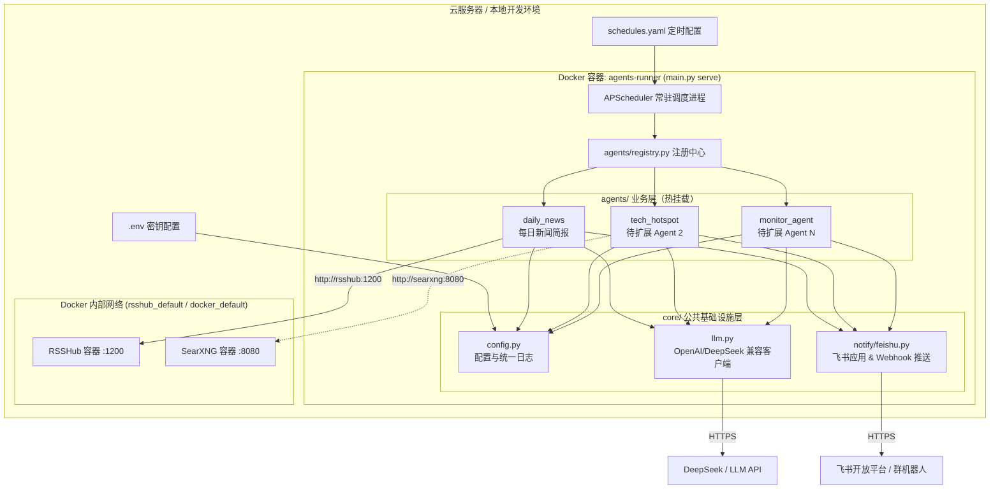

# 多 Agent 容器化底座架构方案

随着个人业务场景增多（如早间新闻简报、晚间科技热榜、竞品动态监控等），如果**每写一个 Agent 就单独建一个 Docker 容器与一套配置**，不仅浪费云服务器内存，而且大模型调用、飞书消息推送等重复代码会散落在各个仓库中难以维护。

为此，本项目采用 **「单容器多 Agent 统一底座（`agents-runner`）」** 架构。

---

## 一、整体架构图



---

## 二、核心设计决策（Why）

### 1. 为什么用 `APScheduler` 替代容器内 `crond`？
在轻量 Linux 容器中使用传统系统 `crond` 有三个常见痛点：
1. **环境变量丢失**：`crond` 子进程默认不继承 Docker `env_file` 注入的环境变量，必须额外写导出脚本；
2. **时区与日志割裂**：`crond` 输出需重定向到 `/proc/1/fd/1` 才能被 `docker logs` 捕获，异常堆栈也缺乏统一上下文；
3. **重叠执行风险**：某个任务偶发卡慢时，cron 可能拉起第二个重叠实例。

使用 Python 原生 `APScheduler`（见 `main.py` 中的 `cmd_serve`）：
- 天然共享进程内的 `.env` 配置与 `core.config` 日志器；
- 通过 `_safe_scheduled_run` 捕获单个 Agent 的运行期异常，**单个 Agent 报错绝不会导致整个容器退出**；
- 内置 `max_instances=1`、`coalesce=True` 与 `misfire_grace_time=300`，防止任务堆积与并发冲突。

### 2. 代码与调度表只读热挂载（免重构建）
在 `docker-compose.yml` 中将 `./core`、`./agents`、`./main.py`、`./schedules.yaml` 以 `:ro`（只读）方式挂载进容器：
- **平时调优 Prompt 或增删订阅源**：在宿主机保存代码（或 `git pull`），**无需重新 `docker compose build`**，下一次定时触发或手动 `docker exec` 立即生效；
- **新增或修改定时时间**：编辑 `schedules.yaml` 后执行 `docker compose restart`（耗时 1 秒）即可重载时间表；
- **何时才需要重新 build**：仅在修改了 `requirements.txt` 新增第三方 Python 库时，执行 `docker compose up -d --build`。

### 3. 本地调试与线上容器无缝兼容
- **数据源地址切换**：本地调试通过 `.env` 配置 `RSSHUB_BASE_URL=http://127.0.0.1:1200`（配合 SSH 端口转发 `ssh -L 1200:127.0.0.1:1200 ubuntu@服务器IP`）；服务器上 `docker-compose.yml` 默认指向 Docker 内网 `http://rsshub:1200`。
- **分级试运行开关**：统一在 `main.py run <agent>` 提供 `--collect-only`（只测采集）和 `--dry-run`（只跑生成、不推飞书），避免调试期往正式飞书群刷屏。

---

## 三、如何新增一个 Agent？（标准 3 步 SOP）

假设我们要新增第 2 个 Agent **`tech_hotspot`**（晚间科技热榜）：

### 第 1 步：创建业务模块 `agents/tech_hotspot/agent.py`

直接复用 `core/` 提供的配置、日志、LLM 与飞书通知器：

```python
from core.config import Settings, get_logger
from core.llm import LLMClient
from core.notify.feishu import FeishuNotifier

logger = get_logger("agents.tech_hotspot")


def run(
    settings: Settings | None = None,
    *,
    dry_run: bool = False,
    collect_only: bool = False,
) -> str:
    """晚间科技热榜 Agent 主入口。"""
    cfg = settings or Settings.from_env()
    # 1. 拉取数据 ...
    raw_data = "..."
    if collect_only:
        print(raw_data)
        return raw_data

    # 2. 调用大模型总结
    content = LLMClient(cfg).chat(
        system_prompt="你是科技资讯编辑...",
        user_prompt=raw_data,
    )
    print(content)

    # 3. 推送飞书（也可传 receive_id 发往不同的群）
    if not dry_run:
        FeishuNotifier(cfg).send_text(content)
    return content
```

### 第 2 步：在 `agents/registry.py` 登记一行

```python
from agents.tech_hotspot.agent import run as run_tech_hotspot

AGENT_REGISTRY = {
    # ... 已有 Agent
    "tech_hotspot": AgentSpec(
        name="tech_hotspot",
        title="晚间科技热榜 Agent",
        description="汇总 IT之家、少数派与微博科技热榜，每晚推送。",
        default_cron="0 20 * * *",
        doc_path="docs/agents/02-tech-hotspot.md",
        runner=run_tech_hotspot,
    ),
}
```

### 第 3 步：在 `schedules.yaml` 开启定时 & 编写配套文档

1. 在 `schedules.yaml` 的 `jobs:` 下添加：
   ```yaml
   tech_hotspot:
     enabled: true
     cron: "0 20 * * *"
   ```
2. 本地验证：`python main.py run tech_hotspot --dry-run`
3. 在 `docs/agents/02-tech-hotspot.md` 补齐设计说明，并在 `docs/_sidebar.md` 加上目录链接。
4. 服务器拉取代码并执行 `sudo docker compose restart` 即可上线。

---

## 四、服务器部署与日常运维速查

```bash
# 1. 首次在服务器部署
git clone <你的仓库地址> /home/ubuntu/agent-learning
cd /home/ubuntu/agent-learning
cp .env.example .env
nano .env                     # 填入 DeepSeek Key 与飞书凭证，并设置 RSSHUB_BASE_URL=http://rsshub:1200
chmod 600 .env

# 确认服务器 RSSHub 容器所在的网络名（如 rsshub_default 或 docker_default）
sudo docker ps --format "table {{.Names}}\t{{.Networks}}" | grep rsshub
# 若网络名为 docker_default，可在 .env 中加一行 DOCKER_SHARED_NETWORK=docker_default

# 构建并后台启动常驻调度容器
sudo docker compose up -d --build

# 2. 日常运维常用命令
sudo docker logs --tail 100 -f agents-runner                     # 实时查看调度与运行日志
sudo docker exec agents-runner python main.py list               # 查看容器内注册的 Agent
sudo docker exec agents-runner python main.py run daily_news     # 随时手动触发一次推送
sudo docker compose restart                                      # 修改 schedules.yaml 或 .env 后生效
```
