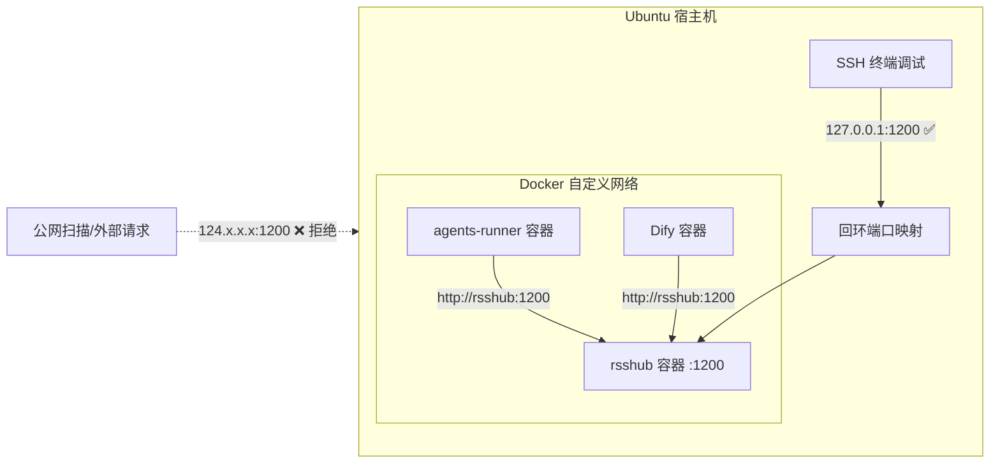

# RSSHub & SearXNG 部署与 Docker 内网隔离实战

本文整理自云服务器搭建 Agent 数据源底座时的真实排障过程，重点记录 **国内云主机信息源选型、Docker 跨项目内网通信、Dify `ssrf_proxy` 代理拦截排障，以及容器网络解耦** 四大核心经验。

---

## 一、国内云主机：SearXNG vs RSSHub 怎么选？

在国内云服务器（如腾讯云）直接裸跑 SearXNG 搜新闻时，实测结果如下：
- **境外引擎（Google News / DuckDuckGo / Brave / Reuters）**：无出站代理时全部连接超时；
- **国内引擎（百度 / 搜狗微信）**：极易触发验证码反爬导致 `parsing error`；
- **可用引擎（Bing 网页版 / 360 搜索）**：大多返回百科词条或新闻频道聚合首页，缺少精确发布时间，`categories=news` 下几乎返回 `0` 条。

**结论**：
- **定时资讯简报 / 行业监控场景**：优先自建 **RSSHub**（配合官方原生 RSS，如 `https://36kr.com/feed`、`https://sspai.com/feed`），时效在分钟级（约 5～15 分钟），自带干净正文与时间戳，且完全免费可控。
- **开放域长尾关键词检索场景**：给 SearXNG 配置稳定的境外代理，或接入国内商业 AI 搜索 API（如博查 Bocha）。

---

## 二、安全加固：用 Docker 内网替代公网端口暴露

自建的 SearXNG（8080）或 RSSHub（1200）没有任何默认鉴权。一旦通过 `0.0.0.0:8181:8080` 暴露到公网，极易被扫描器盗刷流量，导致服务器 IP 被上游网站封禁。

### 正确的网络拓扑设计



### 关键配置要点
1. **端口只绑定本机回环地址**：在 `docker-compose.yml` 中写 `"127.0.0.1:1200:1200"` 而非 `"1200:1200"`。
   - **注意**：Docker 映射的 `0.0.0.0` 端口会直接操作 `iptables` 绕过宿主机 `ufw` 防火墙，因此必须显式指定 `127.0.0.1:` 配合云厂商安全组双重收敛。
2. **容器间使用「服务名 + 容器内部端口」通信**：
   - 每个容器都有自己独立的 `127.0.0.1`，在 `agents-runner` 或 `Dify` 容器里请求 `127.0.0.1:1200` 访问的是它自己，必然连接失败。
   - 加入同一自定义 Docker 网络后，Docker 内置 DNS（`127.0.0.11`）会自动把 `docker-compose.yml` 中的服务名（如 `rsshub`、`searxng`）解析为对应容器的内网 IP。
3. **避免跨项目服务名冲突**：
   - 当把 RSSHub 接入 Dify 的 `docker_default` 网络时，由于 Dify 自身已经有一个名叫 `redis` 的服务，RSSHub 自己的 Redis 服务名**必须改名为 `rsshub-redis`**，且只挂载在 RSSHub 自己的 `default` 网络上，防止 DNS 同名冲突与数据串库。

---

## 三、经典踩坑：Dify HTTP 节点请求内网容器返回 `404 page not found`

### 现象还原
将 `searxng` / `rsshub` 容器加入 Dify 的 `docker_default` 网络后：
- 在 `docker-api-1` 容器内直接 `curl http://searxng:8080/search?q=test&format=json` **正常返回 JSON**；
- 但在 Dify 工作流 HTTP 节点中运行（或通过 `-x http://ssrf_proxy:3128` 代理访问）却返回纯文本 `404 page not found`。

### 根因定位
查看 `docker-ssrf_proxy-1` 的 `/var/log/squid/access.log` 发现：

```text
TCP_MISS/404 ... GET http://searxng:8080/search? - FIRSTUP_PARENT/172.23.0.3 text/plain
```

Dify 的出站代理 Squid 配置了 `cache_peer sandbox parent 8194`，默认把普通 HTTP 请求转发给了 Go 编写的 `sandbox` 容器（`FIRSTUP_PARENT`），因此拿到的是 `sandbox` 返回的 Go 默认 404！

### 修复方案
编辑 Dify 目录下的 `ssrf_proxy/squid.conf.template`（修改模板文件以防容器重启被覆盖），让内网数据源域名走直连：

```squid
# 访问内网 SearXNG 与 RSSHub 时直连，不经过 sandbox 上游
acl internal_tools dstdomain searxng rsshub
always_direct allow internal_tools
```

随后重启代理容器：`sudo docker compose restart ssrf_proxy`，日志变为 `HIER_DIRECT` 即宣告打通。

---

## 四、服务生命周期解耦：避免 `docker compose down` 拖垮业务服务

当多个 Compose 项目（如 `agents-runner`、业务后端 `NestJS`、`SearXNG`、`RSSHub`）需要互通时，**谁创建网络、谁加入网络**非常有讲究：

- **反模式**：让主业务 `NestJS` 在 `docker-compose.yml` 中声明 `external: true` 去依赖 `searxng_default` 网络。一旦日后下线并执行 `docker compose down` 删除了 SearXNG，`searxng_default` 网络随之销毁，会导致 `NestJS` 下次重启时报 `network declared as external, but could not be found` 而**整个主服务无法启动**！
- **推荐做法（两种二选一）**：
  1. **创建一个不属于任何单项目的独立共享网络**：
     ```bash
     sudo docker network create agent-infra-net
     ```
     让提供基础能力的 `rsshub`、`searxng` 与消费方 `agents-runner`、`NestJS` 都以 `external: true` 接入 `agent-infra-net`。任何单一服务下线销毁都不会删掉该网络。
  2. **反转依赖方向**：由可选工具容器（如 `rsshub`）去加入主服务的网络，而不是让核心业务容器去依赖可选工具的默认网络。
